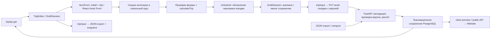

# Аудит редактора событий и план Event Editor UI Kit

## Дополнение Stage 2: границы playground

**Обновление:** после обратной связи playground использует непосредственно production-компоненты `ItemForm` и `Modal` с теми же секциями и шириной панели. Данные и сохранение локальные, клиент карт временно заменяется заглушкой. Описанная ниже отдельная композиция относится к первоначальной версии playground.

Целиком переиспользовать эти секции без изменения их поведения пока нельзя: `CostSection` объединяет поля с настройками расчёта, валюты, курса и изменениями `price_pending`/`included`; `EventRouteSection` включает выбор мест и `TransportEndpoints`, в том числе сетевой поиск; `EventScheduleSection` привязан к дням поездки и размещает UTC внутри расписания. Playground требует локальных данных без сети и отдельной секции UTC, поэтому простое встраивание этих обёрток меняло бы состав и поведение формы.

Перед интеграцией следует выделить чистые управляемые поля стоимости и участников, поля маршрута и адресов, а также контролы дат, времени и UTC; поиск мест и обработку производственных действий оставить в адаптерах существующих секций. Для каждого выделения нужны parity-тесты существующих и новых компонентов: значения и ошибки, переключение режимов стоимости и неизвестной цены, выбор мест и ссылок, даты и UTC, раскрытие секций, сохранение и повторное открытие данных. Только после этих проверок можно подключать общие поля к production.

Дата: 26.11.2026. Область: статический аудит Constructor, связанных API, хранения и обмена. Продуктовый код не менялся; поведение в браузере и тесты в этом этапе не запускались. Пути ниже относительные к корню репозитория. **Факт** означает подтверждение исходным кодом, **риск** — возможное последствие, а не доказанный дефект.

## 1. Текущее устройство

**Факт.** Страницы [полного редактора](<../apps/trip-constructor/src/app/admin/(private)/trips/[id]/page.tsx>) и [пошагового конструктора](<../apps/trip-constructor/src/app/admin/(private)/trips/[id]/builder/page.tsx>) используют [TripEditor](../apps/trip-constructor/src/components/trips/trip-editor.tsx): он открывает [ItemForm](../apps/trip-constructor/src/components/trips/item-form.tsx) в диалоге и inline через [TripBuilder](../apps/trip-constructor/src/components/trips/trip-builder.tsx). Самостоятельных страниц редакторов категорий не найдено. `ItemForm` владеет React Hook Form, переключением типа, предварительным расчётом, проверками и композицией. Уже существующий [EventEditorShell](../apps/trip-constructor/src/components/trips/event-editor-shell.tsx) оборачивает форму, раскрывает вложенные `details` при ошибках; `EventEditorSection` показывает сводку либо сообщение об ошибке.

**Факт.** В [trip-ui.ts](../apps/trip-constructor/src/lib/trip-ui.ts) выбор предлагает перелёт, трансфер, проживание, питание и активность; дополнительный расход доступен для соответствующего существующего типа. Контракт [contracts.ts](../apps/trip-constructor/src/lib/contracts.ts) также содержит legacy-типы `train_bus`, `excursion`, `rental`, `insurance`, отображаемые через категории и подвиды. В long-haul выбор ограничен перелётом и трансфером, а taxi/walk исключены с учётом исходного подвида. Проверены все ветви диспетчера, включая legacy: это не отдельные специализированные редакторы.

| Компонент / поля | Фактическое применение и границы |
|---|---|
| [EventEditorShell / EventEditorSection](../apps/trip-constructor/src/components/trips/event-editor-shell.tsx) | Общая форма; сворачиваемые секции используются перелётом и экскурсией, остальные категории показывают обычные fieldset. Ошибки привязаны к верхнеуровневым ключам `ItemInput`. |
| [EventRouteSection / EventScheduleSection](../apps/trip-constructor/src/components/trips/event-itinerary-sections.tsx) | Название, место, дни, время и расписание; слоты географии. Проживание использует даты заезда/выезда; транспорт — конечные точки и UTC. Перелёт использует собственные поля маршрута. |
| [CostSection](../apps/trip-constructor/src/components/trips/event-editor-shared.tsx) | Общие цена, валюта, курс, участники, количество и режимы; внутри есть условия проживания, ручные номера, статус неизвестной цены и правила включения. Конфигурация меняет подписи и основные режимы. |
| [LinksFields / NotesSection](../apps/trip-constructor/src/components/trips/event-editor-shared.tsx) | Ссылки с общей настройкой публикации, описание, клиентская и внутренняя заметки. Ссылки явно показаны для перелёта, экскурсии и проживания; остальные ветви не показывают их, хотя данные могут существовать. |
| [EventStagesSection](../apps/trip-constructor/src/components/trips/event-stages-section.tsx) | Общие этапы и этапы перелёта; у перелёта особая подсказка о бронировании. Проживание не показывает этапы. |
| [FlightEditor](../apps/trip-constructor/src/components/trips/flight-editor.tsx), [fields](../apps/trip-constructor/src/components/trips/flight-editor-fields.tsx), [sections](../apps/trip-constructor/src/components/trips/flight-editor-sections.tsx) | Собственные сводка, аэропорты, страны/города, даты, UTC и интервалы аэропорта; использует общие стоимость, ссылки, заметки и этапы. |
| [ExcursionEditor](../apps/trip-constructor/src/components/trips/excursion-editor.tsx), [ExcursionStages](../apps/trip-constructor/src/components/trips/excursion-stages.tsx) | Особые место встречи/окончания, программа и сводка; общие расписание, стоимость, ссылки и заметки. Этапы программы имеют отличающееся представление и поведение. |
| Прочие типы | Общая форма с подписями из `ItemForm`; у проживания особые место на карте, даты, ночи и режим номера. Трансфер и legacy-транспорт используют соответствующие конечные точки. Не считать их одинаковыми только по внешнему виду. |

География также использует [LocationPicker](../apps/trip-constructor/src/components/trips/location-picker.tsx), [PlaceCombobox](../apps/trip-constructor/src/components/trips/place-combobox.tsx), [transport-endpoints](../apps/trip-constructor/src/components/trips/transport-endpoints.tsx) и [country-city](../apps/trip-constructor/src/components/trips/country-city.tsx). Стили разделены между [глобальными стилями Constructor](../apps/trip-constructor/src/app/globals.css), [токенами](../apps/trip-constructor/src/design-system/tokens.css), [event-editor.module.css](../apps/trip-constructor/src/components/trips/event-editor.module.css), [flight-editor.module.css](../apps/trip-constructor/src/components/trips/flight-editor.module.css) и [excursion-editor.module.css](../apps/trip-constructor/src/components/trips/excursion-editor.module.css). Экскурсия импортирует стили перелёта для общего оформления. Есть и токены, и буквальные цвета в секциях. Общая сетка становится одноколоночной на 640px; поля маршрута перелёта — на 520px, действия — на 420px. Это правила кода, а не результат визуальной проверки.

## 2. Поток данных

**Факт.** [trip-editor.tsx](../apps/trip-constructor/src/components/trips/trip-editor.tsx) загружает через `tripApi.get`, держит черновик в [draft-session.ts](../apps/trip-constructor/src/lib/draft-session.ts) и запускает autosave с задержкой 800 мс. Применение формы изменяет черновик; это не отдельный запрос сохранения события. [trips.ts](../apps/trip-constructor/src/lib/trips.ts) явно преобразует документ в `TripInput` и отправляет полный PUT. Backend в [trips.py](../backend/app/trips.py) проверяет версию и сохраняет дочерние записи в транзакции; [models.py](../backend/app/models.py) хранит событие как `TripItem`, этапы — JSONB. Контракт — [schemas.py](../backend/app/schemas.py). Серверный расчёт авторитетен; фронтендовый [pricing.ts](../apps/trip-constructor/src/lib/pricing.ts) используется для предварительной оценки, а `TripEditor` обнаруживает расхождение с сервером.

**Факт.** Форма наблюдает поля через `useWatch`; курс хранится отдельно, некоторые переходные значения — в refs. При сохранении существующего события изменённые поля накладываются на `initial`, чтобы не перезаписать скрытые или legacy-поля; новые значения нормализуются. При смене типа намеренно меняются режим, подвид, даты и некоторые UTC-поля; выход из перелёта требует подтверждения. Валидация распределена между секциями, `ItemForm`, расчётом и сервером. Не следует заменять эти правила только визуальной конфигурацией.

**Факт.** [trip-export.ts](../apps/trip-constructor/src/lib/trip-export.ts) использует тот же `tripInput`; экспорт из редактора проверяет версию и добавляет snapshot для reimport. [trip-list.tsx](../apps/trip-constructor/src/components/trips/trip-list.tsx) загружает JSON через import API; [trip_reimport_api.py](../backend/app/trip_reimport_api.py) сравнивает со снимком и применяет выбранные изменения с резервной копией. Формат и версия заданы в схемах. Клиентский [preview.tsx](../apps/trip-constructor/src/components/trips/preview.tsx) и [public_trips.py](../backend/app/public_trips.py) — разные проекции; публичный API включает этапы с `notes`, но в проверенном [trip-itinerary.tsx](<../apps/website/src/app/(private)/trip/trip-itinerary.tsx>) этапы объявлены в типе и не отображаются. Назначение `notes` этапа как публичного или внутреннего не установлено: требуется решение о семантике до изменения отображения или API.

## 3. Риски и подтверждённые различия

| Приоритет | Наблюдение → риск |
|---|---|
| P1 | Публичный API передаёт `EventStage.notes`; их видимость в UI и предполагаемая приватность не определены. Возможное раскрытие зависит от бизнес-семантики; наличие данных в API подтверждено, утечка внутренних заметок не доказана. Проверить контракт и потребителей. |
| P1 | Изменение типа явно сбрасывает некоторые поля и режимы; восстановление в refs частичное и ограничено текущим сеансом формы. При сохранении переход может изменить данные. Скрытие само по себе не доказано как потеря: dirty-merge и существующие тесты защищают неизменённые поля. Нужна матрица переходов и round-trip до миграции UI. |
| P1 | `tripInput` перечисляет поля явно и используется PUT и экспортом: новое поле можно случайно потерять в обоих путях. Добавление UI-поля требует проверки схемы, преобразования, БД, JSON и проекций. |
| P2 | `CostSection` содержит семантику проживания и состояния цены, `ItemForm` — правила нескольких категорий; общие компоненты зависят от `ItemInput`, `TripInput` и RHF. Это усложняет изоляцию и повышает риск регрессии при изменении категории. Прямых вызовов API в просмотренных секциях нет; общие типы отражают API-контракт, что не равно прямой зависимости от БД. |
| P2 | Отдельные `costSummary`, заголовки, реестры секций и порядок статусов в flight/excursion: например, при одновременно неизвестной и исключённой цене приоритет текста различается. Это подтверждённое расхождение, не утверждение о неверном бизнес-правиле. |
| P2 | Создание подвидов и смена типа используют разные пути установки режима (например, некоторые транспортные подвиды против default transfer). Поведение следует зафиксировать тестами и согласовать, прежде чем унифицировать. |
| P2 | Разные оболочки секций, ссылки и наборы этапов у категорий; общие стили экскурсии живут в файле перелёта. Изменения CSS или общих компонентов могут затронуть обе категории. Различия могут быть намеренными. |
| P3 | Списки полей для статуса секции поддерживаются вручную, включая вложенные этапы; рассинхронизация возможна. Требуется тест вложенных ошибок и раскрытия, а не предположение, что оно уже сломано. |

## 4. Предлагаемая архитектура и назначение

1. **Переиспользовать и постепенно уточнить `EventEditorShell` и `EventEditorSection`**, а не создавать второй shell. Он отвечает за форму, действия, доступное раскрытие и ошибку секции; категория передаёт заголовок, содержимое и сводку. Это устраняет разные механизмы сворачивания, сохраняя существующее раскрытие ошибок. Не связывать shell с маршрутом, API или категориями; границу RHF выносить только вместе с проверенными адаптерами.
2. **Композиция явных редакторов**, а не универсальная JSON-конфигурация полей: `FlightEditor`, `ExcursionEditor`, общий редактор и существующая особая ветвь проживания выбирают секции и содержат профильные правила. Общие компоненты — маршрут/расписание там, где семантика совпадает; `CostSection`, ссылки, заметки и контролы места. Аэропорты/UTC, ночи/номера и программа экскурсии остаются специализированными. Это ограничивает влияние изменений на другие категории и не стирает бизнес-различия.
3. **Общий каркас сводки/статуса** с явными значениями `error`, `warning`, `incomplete`, `ready`, но конкретные условия и текст вычисляет категория. До переноса согласовать приоритет неизвестной и исключённой цены. Ошибка должна раскрывать секцию и вести к полю; предупреждение не блокирует сохранение без существующего правила. Это устраняет расхождение presentation, не меняя валидацию.
4. **Контролы и секции работают с переданным состоянием/действиями либо текущим form context**, без получения данных сети. Адаптер production остаётся владельцем `ItemForm`, расчёта и `onSubmit`; playground предоставляет те же контракты из локальных fixtures и подменяет сохранение in-memory. Такой шов позволяет использовать один UI без второй реализации; выделять более низкоуровневый API только там, где он реально нужен обоим потребителям.
5. **Стили в пределах Constructor**: вынести повторяемые стили заголовка/секций из файла перелёта в нейтральный модуль, опираясь на локальные токены; сохранить мобильные точки, фокус, семантические `details` и совместимость inline/диалога. Это убирает неявную зависимость экскурсии от CSS перелёта без межприложенческого импорта.

## 5. План следующих этапов

1. Зафиксировать контракт сохранности: таблица всех типов/подвидов, видимых и скрытых полей, переходов, default/legacy режимов, notes и ссылок; согласовать публичность stage notes. Добавить недостающие characterization-тесты до переноса. Никаких изменений JSON/API/БД ради playground.
2. Создать **dev-only** маршрут или отдельную dev-точку внутри Constructor, недоступную в production-сборке/маршрутизации; проверить это автоматическим тестом и фактическим production build. Использовать только синтетические `TripInput`/`ItemInput`, локальное состояние и mock callbacks без сети, авторизации и доступа к реальной БД. Варианты: все категории и legacy, новый/сохранённый, заполнено/пусто, ошибки, неизвестная цена, валюты, этапы и мобильная ширина. Точный механизм исключения маршрута определить при реализации по возможностям Next.js; простого скрытия ссылки недостаточно.
3. Подключить существующий `ItemForm` и реальные секции к mock-хосту; сначала доказать отсутствие сетевых запросов и одинаковое поведение с production, затем извлекать только повторяющиеся presentation-части. Имитируемое сохранение показывает полученный объект и позволяет переоткрыть его в памяти. Playground не должен подменять серверную финансовую проверку.
4. Переносить категории по одной, начиная с двух уже композиционных редакторов; сверять снимки данных до/после, сводки и поведение в обоих контейнерах. Далее рассмотреть общую и гостиничную ветви без изменения их бизнес-правил. Подключать к production те же компоненты через существующий адаптер; удалять старые элементы только после проверок parity.
5. После каждого переноса проверять полный путь и регрессии; при обнаружении фактического дефекта оформлять отдельное решение, не исправлять незаметно в рамках унификации.

## 6. Проверки и зоны регрессии

- Существующие [item-form.test.tsx](../apps/trip-constructor/src/components/trips/item-form.test.tsx), [flight-editor.test.tsx](../apps/trip-constructor/src/components/trips/flight-editor.test.tsx), [event-itinerary-sections.test.tsx](../apps/trip-constructor/src/components/trips/event-itinerary-sections.test.tsx), [trip-editor.test.tsx](../apps/trip-constructor/src/components/trips/trip-editor.test.tsx), [cost-section.test.tsx](../apps/trip-constructor/src/components/trips/cost-section.test.tsx) и [backend roundtrip](../backend/tests/test_flight_editor_roundtrip.py) — основа, не свидетельство прохождения в этом аудите.
- Round-trip открытия и сохранения без изменений для каждого типа и legacy, скрытых ссылок, этапов, null/отсутствующих значений и неизвестной цены; переключения типов туда и обратно, предупреждения и подтверждения.
- Даты/UTC и переход через сутки, отель/ночи/номера, участники и вместимость, режимы стоимости, курсы и серверный parity, распределение многодневной суммы, отмена и ошибки сохранения, конфликт версий.
- Вложенные ошибки, раскрытие секции и фокус, клавиатура, сохранение состояния сворачивания, ссылки и их публикация, внутренние и клиентские заметки, этапы и порядок; inline и диалог на desktop/tablet/mobile.
- PUT → БД → reopen; JSON export/import/reimport со snapshot и legacy-полями; приватный preview и публичный API/Website по согласованной семантике. Playground: fixtures не вызывают сеть, нет доступа к реальным данным, production route недоступен.
